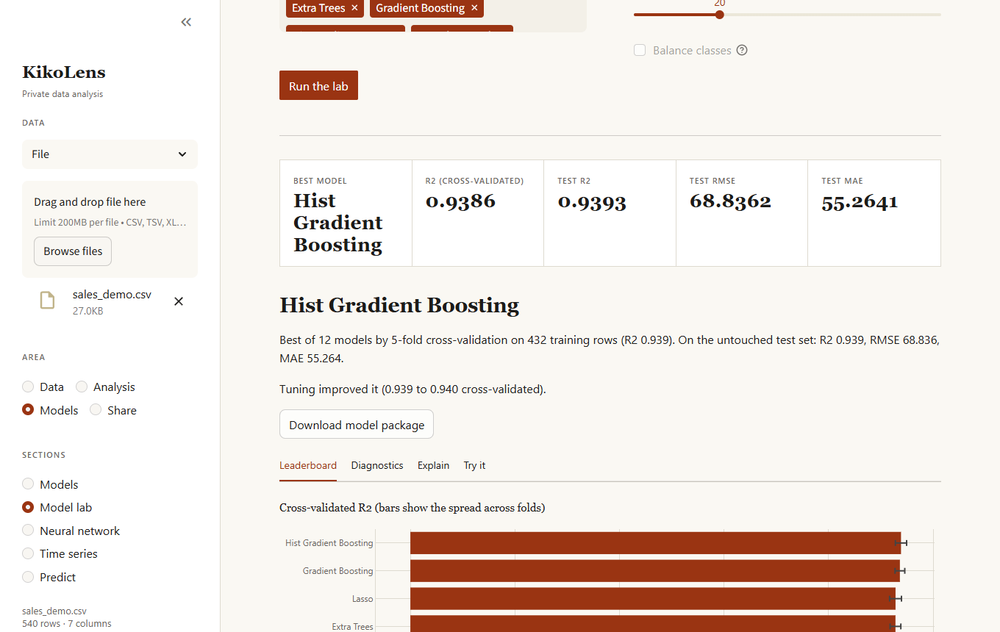
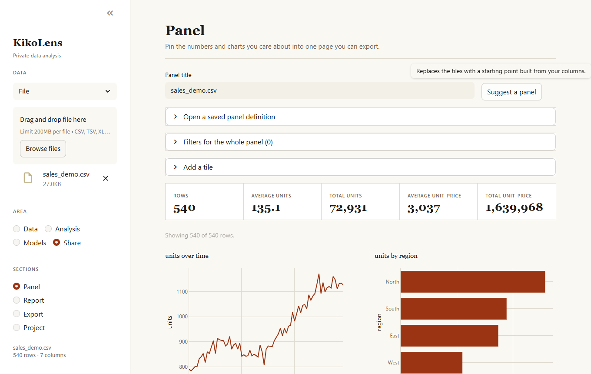
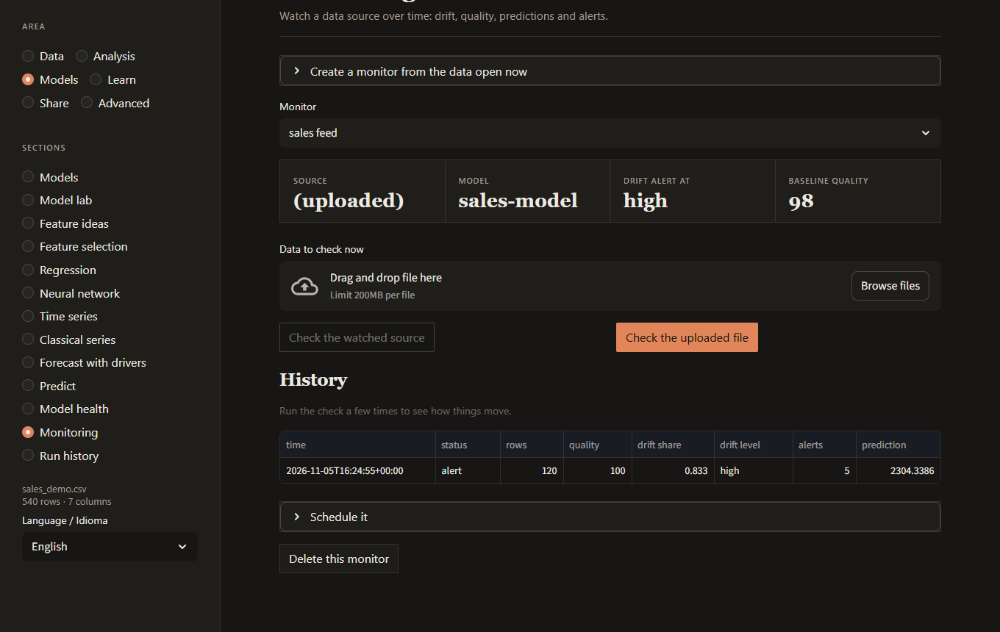
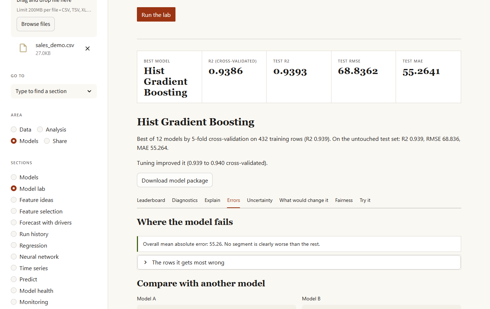
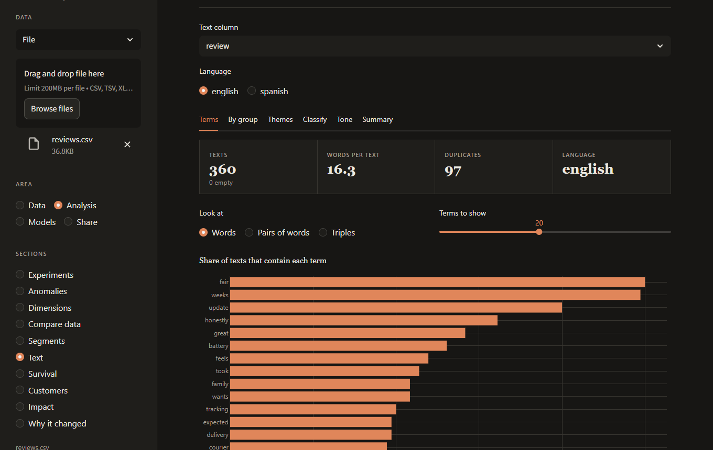
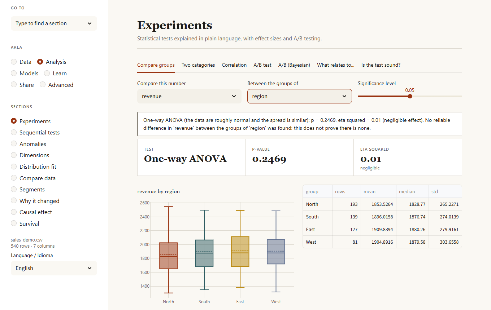
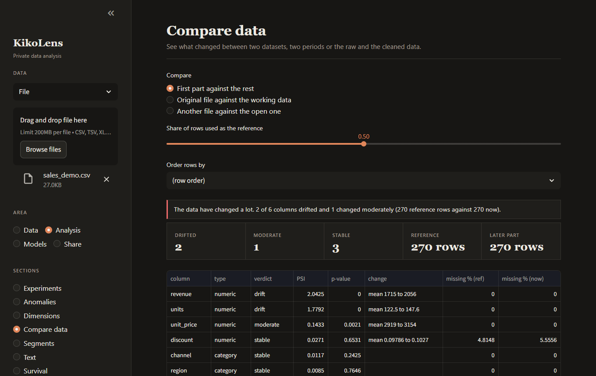

# KikoLens

Private, local-first data analysis. Load a dataset, let the autopilot take a first pass, check its quality and fix it, reshape it, explore it, test hypotheses, compare many models and understand them, forecast, study customers and the effect of a change, watch a data source over time, and keep what you built: a recipe you can replay, a model you can score new data with (or serve behind a small local API), a panel and a report in HTML or PDF. Nothing leaves your machine; language-model features use [Ollama](https://ollama.com/) running locally.



<table>
  <tr>
    <td></td>
    <td></td>
  </tr>
  <tr>
    <td></td>
    <td></td>
  </tr>
  <tr>
    <td></td>
    <td></td>
  </tr>
</table>

## What it does

The dashboard groups its sections into four areas.

| Area | Section | What it does |
| :--- | :--- | :--- |
| **Data** | Load | CSV, TSV, Excel (pick the sheet), JSON / NDJSON, Parquet, a pasted table, `http(s)` links, shared Google Sheets, `s3://` and `gs://` (with the `cloud` extra), and SQLite / PostgreSQL / MySQL (pick a table or run a read-only query). |
| | Quality and cleaning | Quality score and detection of missing values, duplicates, constant columns, text that is really numbers or dates, and outliers. Missing-data patterns (are the gaps random?), smart fill (KNN, iterative, by group), merging of similar spellings, near-duplicate rows, and your own validation rules. Every fix is undoable; the original file is never touched. |
| | Privacy | Finds personal data (validated patterns and column names), masks, hashes or removes it as recipe steps, and measures how identifiable people are with k-anonymity. |
| | Match records | Joins two tables whose names are spelled differently (accents, order, typos), with ambiguity warnings. |
| | Transform | Filter, sort and sample rows; formulas for new columns; date parts, bins, scaling, one-hot encoding; lags and rolling statistics; group, pivot and stack; join or append a second file. |
| | Autopilot | A first full analysis in one click: safe cleaning as a recipe, column roles, findings, a model against a baseline and a forecast when there are dates, with a written summary and next steps. |
| | Explore, Patterns, Statistics | Charts with filters, automatic findings (strong correlations, dominant categories, identifiers), summary tables and the correlation matrix. |
| | Ask | Question the data in plain language (a local model writes the SQL) or run your own read-only SQL. |
| **Analysis** | Experiments | Compare groups (the right test is chosen for you, with effect size and post-hoc comparisons), association between categories, correlation with confidence intervals, A/B tests (classical and Bayesian) with sample-size planning, and a screen of every column against a target corrected for testing many at once. |
| | Anomalies | Isolation Forest, Local Outlier Factor, robust z-score or Mahalanobis distance, with the reason each row was flagged; and periods of a series that are unusual once trend and season are taken out. |
| | Dimensions | PCA with loadings, t-SNE maps, and a redundancy check (VIF). |
| | Compare data | What changed between two datasets, two periods, or the raw and the cleaned data: PSI, KS and chi-squared per column. |
| | Text | For comments and reviews: key terms, what distinguishes each group, themes, a classifier, rough tone, search, and an optional summary from the local model. |
| | Segments | k-means clustering with a silhouette hint for the number of groups. |
| | Survival | Kaplan-Meier curves with confidence bands and a log-rank test between groups, counting cases where the event has not happened yet. |
| | Customers | Retention by cohort, RFM segments, conversion funnels and what is bought together. |
| | Why it changed | A figure moved between two periods: which regions, channels or products explain it, with a waterfall and mix and rate effects for averages. |
| | Impact | Did a change move the numbers? Compared with what a control or the earlier trend predicted, with a range that reflects how wrong that method was before; also difference-in-differences. |
| **Models** | Models | AutoML for regression and classification with a written rationale, feature importance, row explanations and a what-if simulator. |
| | Model lab | Up to 12 models (a baseline included) compared with cross-validation, the best one tuned, data-leak detection, diagnostics, partial dependence, Shapley values, **where the model fails**, decision thresholds with costs, a row-by-row comparison of two models, ranges that hold the truth as often as you ask (conformal), the smallest changes that would flip a prediction, and a fairness check across groups. SVM, AdaBoost, Bagging, voting and stacking ensembles, and an optional PyTorch network, are available too. |
| | Regression | What pushes a result up or down, other things equal: linear or logistic regression with ranges, p-values, odds ratios, each effect in a sentence and warnings when the model cannot be trusted. |
| | Feature ideas | Tries ratios, products and other new columns and keeps the ones that make a model better, as recipe steps. |
| | Neural network | Configurable multilayer perceptron with the architecture drawn, the training curve, permutation importance and a comparison with the classical model. |
| | Time series | Trend and seasonality, then five models (naive, seasonal naive, trend + seasonality, Holt-Winters, boosting on lags) tested on the past, the best one forecast with an honest range, changes of level or trend, special dates, and one forecast per group. |
| | Predict | Score a new file with a model, with warnings about missing columns, unseen categories, out-of-range values and dates. Save models, keep versions, export a model card. |
| | Model health | Is a saved model still as good as when tested? Scores newer data with known results period by period and warns of a drop or a steady decline. |
| | Monitoring | Watch a source over time: drift against a baseline, quality, validation rules and the model's predictions, with alerts, history and the command to schedule it. |
| **Share** | Panel | Pin metrics, charts and tables with global filters, and export them as one self-contained web page. |
| | Report | One self-contained HTML page, or a PDF with quality, distributions, correlations, the model and the forecast. |
| | Export | CSV, Excel, Parquet, JSON or Feather; a formatted Excel workbook with the whole analysis; a database table; a data dictionary; or a Jupyter notebook that reproduces the session. |
| | Project | Save everything to a single `.kikolens` file, reopen it later, and repeat the recipe on new data or export it as a Python script. |

## Try it

`examples/` has a synthetic sales dataset with deliberate flaws (missing values, duplicates, prices stored as text) and a weekly pattern, plus companion files:

| File | Use it for |
| :--- | :--- |
| `sales_demo.csv` | Everything: cleaning, models, forecasting. |
| `sales_new_quarter.csv` | A later quarter whose channel mix and prices have shifted. Score it with a model, monitor it, or compare it with the main file in **Compare data**. |
| `regions.csv` | A small table to practice joining (`region`). |
| `reviews.csv` | Customer comments with a rating, for the **Text** section. |
| `report.html` | The report generated from `sales_demo.csv`. |

```bash
kikolens start        # then drop examples/sales_demo.csv into the sidebar
```

A complete session from the terminal:

```bash
kikolens clean examples/sales_demo.csv --output clean.csv --save-recipe recipe.json
kikolens lab clean.csv revenue --exclude units --register sales-model
kikolens monitor create sales-feed clean.csv --model sales-model --recipe recipe.json
kikolens apply examples/sales_new_quarter.csv recipe.json --output new_clean.csv
kikolens score new_clean.csv sales-model --output predictions.csv
kikolens monitor run sales-feed --source examples/sales_new_quarter.csv   # exit code 2: it changed
```

## In a notebook

```python
import kikolens as kl

df = kl.load("sales.csv")
kl.profile(df)                 # quality and problems
kl.autopilot(df)               # a first full analysis
lab = kl.lab(df, "revenue")    # compare models
lab.plot()
```

`kikolens jupyter` writes a quickstart notebook and opens JupyterLab; `%load_ext kikolens` adds magics. See the [Python API guide](docs/python-api.md).

## Install

Requires Python 3.12 or newer.

```bash
git clone https://github.com/Francisco-B-O/kikolens.git
cd kikolens
pip install -e .
```

Optional extras: `pip install -e ".[cloud]"` for `s3://` and `gs://`, `".[postgres]"` and `".[mysql]"` for those databases, `".[jupyter]"` for JupyterLab, `".[torch]"` for the PyTorch network (a large download, so it is not in `all`), and `".[all]"` for the rest.

For the language-model features, install Ollama and pull a model:

```bash
ollama pull llama3.2
```

KikoLens reads these environment variables:

| Variable | Default | Purpose |
| :--- | :--- | :--- |
| `OLLAMA_HOST` | `http://localhost:11434` | Where Ollama is running. |
| `OLLAMA_MODEL` | `llama3.2` | Model used for summaries and plain-language questions. |
| `OLLAMA_TIMEOUT` | `120` | Seconds to wait for the model. |
| `KIKOLENS_HOME` | `~/.kikolens` | Where saved models and monitors are kept. |

Everything except plain-language questions and written summaries works without Ollama.

## Dashboard

```bash
kikolens start            # opens http://localhost:8501
kikolens start --port 9000
```

The dashboard follows the light or dark theme chosen in Streamlit's settings menu.

## Command line

```bash
kikolens analyze data.csv                         # statistics and quality summary
kikolens sql data.csv "SELECT region, SUM(units) FROM df GROUP BY region"
kikolens ask data.csv "Which region sold the most?"
kikolens clean data.csv --output clean.parquet --save-recipe recipe.json
kikolens apply new.csv recipe.json --output new_clean.csv   # repeat a recipe
kikolens validate data.csv rules.json             # exit code 2 when a rule is broken
kikolens predict data.csv revenue --nn --layers "64, 32"    # AutoML or neural network
kikolens lab data.csv revenue --register my-model           # compare, tune, save
kikolens score new.csv my-model --output predictions.csv    # use a saved model
kikolens models                                             # list, info, delete
kikolens forecast data.csv date revenue --horizon 30 --compare --changes
kikolens forecast data.csv date revenue --by region         # one forecast per group
kikolens anomalies data.csv --share 2 --output odd_rows.csv
kikolens screen data.csv churned                  # which columns relate to a target
kikolens ab data.csv variant converted --control A
kikolens text reviews.csv review --group product --themes 4
kikolens drift reference.csv current.csv          # exit code 2 when the data changed a lot
kikolens monitor create NAME SOURCE / run / list / history / watch / schedule / delete
kikolens panel data.csv --output panel.html
kikolens export data.csv out.xlsx --workbook      # formatted workbook with the analysis
kikolens to-db data.csv sqlite:///results.db results
kikolens report data.csv --target revenue --nn --output report.html
kikolens project work.kikolens --output processed.csv
```

In SQL the data is always the table `df`. Only read-only queries run; writes, multiple statements and file-reading functions are rejected. The full list of options is in the [command line reference](docs/cli.md).

## Docker

```bash
docker-compose up -d      # dashboard on :8501, Ollama on :11434
```

The first start downloads the model (about 2 GB) into the `ollama_data` volume. Change the model with `OLLAMA_MODEL=llama3.1 docker-compose up -d`. The image has a health check on Streamlit's health endpoint.

## Good to know

* **Recipes replay, they do not remember data.** Every cleaning and transformation step is recorded with its parameters. A recipe applies to any file with the same columns, and can be exported as JSON or as a Python script. Imputers are fitted again on the data a recipe is applied to.
* **Formulas are not code.** Expressions such as ``price * units`` are read by a small arithmetic interpreter that only allows numbers, columns, operators and a few math functions, so a recipe from someone else cannot run anything. Text that starts with `=` is stored as text in Excel exports, never as a formula.
* **Models are packages.** A saved model carries the columns it expects, their training ranges, its classes and, for regression, the typical size of its errors, so scoring new data can warn you when the data no longer looks like the training data.
* **Monitors do not install anything.** `kikolens monitor schedule` prints the cron and Windows commands; you decide whether to run them. A webhook is called only if you configure one, and only for alerts.
* **Pickles run code.** Model files (`.klmodel`, `.pkl`) are Python pickles. Open only files you created or trust. Project files store data as Parquet and are safe to open; the models inside are loaded only if you tick the box.
* **Writing to a database never overwrites by default.** Replacing a table needs an explicit choice (and a confirmation in the dashboard).
* Dates and numbers stored as text are read as dates and numbers when modeling, and the lab says which columns it converted.
* The tone in the Text section comes from a small word list: it is a rough picture, not a verdict. Interface language is English.

## Documentation

* [Dashboard guide](docs/dashboard.md): every section, with screenshots
* [Command line reference](docs/cli.md)
* [Workflows](docs/workflows.md): from raw file to monitored model
* [How the methods work](docs/models.md): preprocessing, models, tests, anomalies, text, forecasting, drift, monitoring
* [Changelog](CHANGELOG.md)

## Development

```bash
pip install -e ".[dev]"
pytest tests/ -v
python -m build           # builds the wheel, as CI does
```

The screenshots in `docs/images` and the files in `examples/` are regenerated with `pip install -e ".[docs]" && python docs/make_screenshots.py`.

Work happens on feature branches; changes reach `develop` and then `main` through pull requests that pass CI.

## License

MIT
