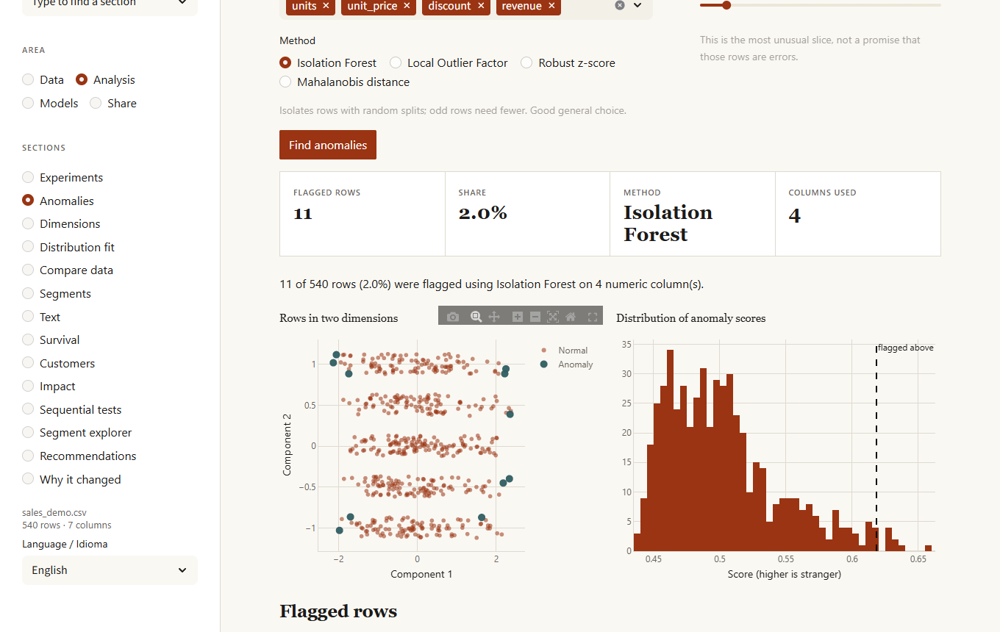
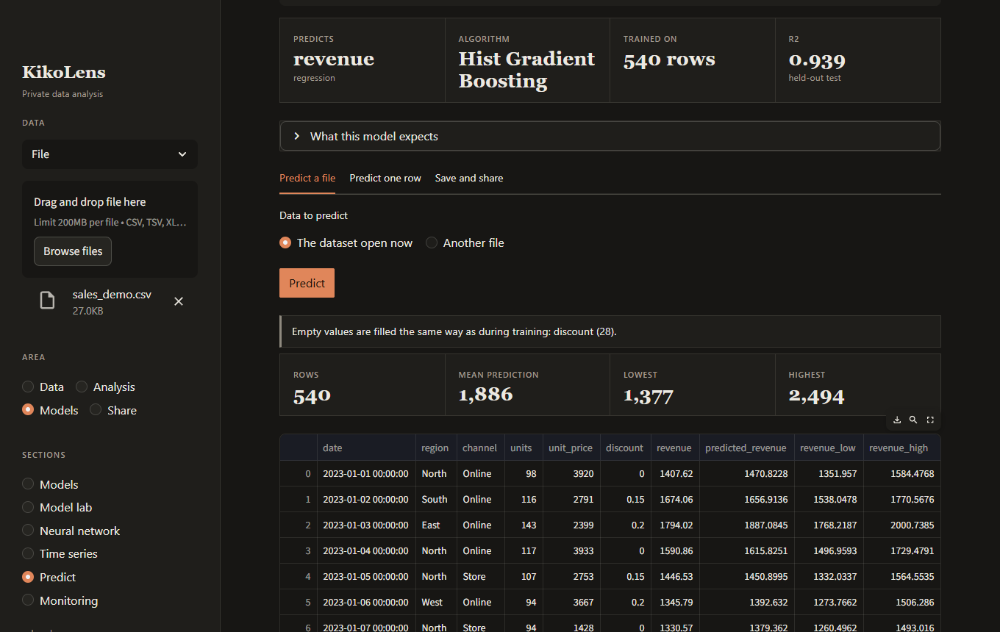

# KikoLens

Private, local-first data analysis. Load a dataset, check its quality, clean and reshape it, explore it, test hypotheses, compare many models, forecast, and keep what you built: a recipe you can replay, a model you can score new data with, and a report. Nothing leaves your machine; language-model features use [Ollama](https://ollama.com/) running locally.


<table>
  <tr>
    <td></td>
    <td></td>
  </tr>
  <tr>
    <td></td>
    <td></td>
  </tr>
</table>

## What it does

The dashboard groups its sections into four areas.

| Area | Section | What it does |
| :--- | :--- | :--- |
| **Data** | Load | CSV, TSV, Excel, JSON / NDJSON, Parquet, `http(s)` links, and SQLite / PostgreSQL / MySQL. |
| | Quality and cleaning | Quality score and detection of missing values, duplicates, constant columns, text that is really numbers or dates, and outliers. Every fix is undoable; the original file is never touched. |
| | Transform | Filter, sort and sample rows; formulas for new columns; date parts, bins, scaling, one-hot encoding; lags and rolling statistics; group, pivot and stack; join or append a second file. |
| | Explore, Patterns, Statistics | Charts with filters, automatic findings (strong correlations, dominant categories, identifiers), summary tables and the correlation matrix. |
| | Ask | Question the data in plain language (a local model writes the SQL) or run your own read-only SQL. |
| **Analysis** | Experiments | Compare groups (the right test is chosen for you, with effect size and post-hoc comparisons), association between categories, correlation with confidence intervals, A/B tests with sample-size planning, and a screen of every column against a target corrected for testing many at once. |
| | Anomalies | Isolation Forest, Local Outlier Factor, robust z-score or Mahalanobis distance, with the reason each row was flagged. |
| | Dimensions | PCA with loadings, t-SNE maps, and a redundancy check (VIF). |
| | Compare data | What changed between two datasets, two periods, or the raw and the cleaned data: PSI, KS and chi-squared per column. |
| | Segments | k-means clustering with a silhouette hint for the number of groups. |
| **Models** | Models | AutoML for regression and classification with a written rationale, feature importance, row explanations and a what-if simulator. |
| | Model lab | Up to 12 models (a baseline included) compared with cross-validation, the best one tuned, data-leak detection, diagnostics (residuals, ROC, precision-recall, calibration, learning curve) and partial dependence. |
| | Neural network | Configurable multilayer perceptron with the architecture drawn, the training curve, permutation importance and a comparison with the classical model. |
| | Time series | Trend, seasonality, and a forecast with a 95% range that is backtested against a naive baseline. |
| | Predict | Score a new file with a model, with warnings about missing columns, unseen categories and out-of-range values. Save models, keep versions, export a model card. |
| **Share** | Report | One self-contained HTML page (print it to PDF from the browser). |
| | Project | Save everything to a single `.kikolens` file, reopen it later, and repeat the recipe on new data or export it as a Python script. |

## Try it

`examples/` has a synthetic sales dataset with deliberate flaws (missing values, duplicates, prices stored as text) and a weekly pattern, plus companion files:

| File | Use it for |
| :--- | :--- |
| `sales_demo.csv` | Everything: cleaning, models, forecasting. |
| `sales_new_quarter.csv` | A later quarter whose channel mix and prices have shifted. Score it with a model, or compare it with the main file in **Compare data**. |
| `regions.csv` | A small table to practice joining (`region`). |
| `report.html` | The report generated from `sales_demo.csv`. |

```bash
kikolens start        # then drop examples/sales_demo.csv into the sidebar
```

A complete session from the terminal:

```bash
kikolens clean examples/sales_demo.csv --output clean.csv --save-recipe recipe.json
kikolens lab clean.csv revenue --register sales-model
kikolens apply examples/sales_new_quarter.csv recipe.json --output new_clean.csv
kikolens score new_clean.csv sales-model --output predictions.csv
kikolens drift clean.csv new_clean.csv
```

## Install

Requires Python 3.12 or newer.

```bash
git clone https://github.com/Francisco-B-O/kikolens.git
cd kikolens
pip install -e .
```

For the language-model features, install Ollama and pull a model:

```bash
ollama pull llama3.2
```

KikoLens reads these environment variables:

| Variable | Default | Purpose |
| :--- | :--- | :--- |
| `OLLAMA_HOST` | `http://localhost:11434` | Where Ollama is running. |
| `OLLAMA_MODEL` | `llama3.2` | Model used for summaries and plain-language questions. |
| `OLLAMA_TIMEOUT` | `120` | Seconds to wait for the model. |
| `KIKOLENS_HOME` | `~/.kikolens` | Where saved models are kept. |

Everything except plain-language questions and written summaries works without Ollama.

## Dashboard

```bash
kikolens start            # opens http://localhost:8501
kikolens start --port 9000
```

The dashboard follows the light or dark theme chosen in Streamlit's settings menu.

## Command line

```bash
kikolens analyze data.csv                         # statistics and quality summary
kikolens sql data.csv "SELECT region, SUM(units) FROM df GROUP BY region"
kikolens ask data.csv "Which region sold the most?"
kikolens clean data.csv --output clean.parquet --save-recipe recipe.json
kikolens apply new.csv recipe.json --output new_clean.csv   # repeat a recipe
kikolens predict data.csv revenue --nn --layers "64, 32"    # AutoML or neural network
kikolens lab data.csv revenue --register my-model           # compare, tune, save
kikolens score new.csv my-model --output predictions.csv    # use a saved model
kikolens models                                             # list, info, delete
kikolens forecast data.csv date revenue --horizon 30
kikolens anomalies data.csv --share 2 --output odd_rows.csv
kikolens screen data.csv churned                  # which columns relate to a target
kikolens ab data.csv variant converted --control A
kikolens drift reference.csv current.csv          # exit code 2 when the data changed a lot
kikolens report data.csv --target revenue --nn --output report.html
kikolens project work.kikolens --output processed.csv
```

In SQL the data is always the table `df`. Only read-only queries run; writes, multiple statements and file-reading functions are rejected. The full list of options is in the [command line reference](docs/cli.md).

## Docker

```bash
docker-compose up -d      # dashboard on :8501, Ollama on :11434
```

The first start downloads the model (about 2 GB) into the `ollama_data` volume. Change the model with `OLLAMA_MODEL=llama3.1 docker-compose up -d`.

## Good to know

* **Recipes replay, they do not remember data.** Every cleaning and transformation step is recorded with its parameters. A recipe applies to any file with the same columns, and can be exported as JSON or as a Python script.
* **Formulas are not code.** Expressions such as ``price * units`` are read by a small arithmetic interpreter that only allows numbers, columns, operators and a few math functions, so a recipe from someone else cannot run anything.
* **Models are packages.** A saved model carries the columns it expects, their training ranges, its classes and, for regression, the typical size of its errors, so scoring new data can warn you when the data no longer looks like the training data.
* **Pickles run code.** Model files (`.klmodel`, `.pkl`) are Python pickles. Open only files you created or trust. Project files store data as Parquet and are safe to open; the models inside are loaded only if you tick the box.
* Dates are turned into numeric features (days since 1970, month, weekday) before training.
* Forecasts use a linear trend plus Fourier seasonality. They are checked on held-out data and the dashboard says when they do not beat repeating the last value.

## Documentation

* [Dashboard guide](docs/dashboard.md): every section, with screenshots
* [Command line reference](docs/cli.md)
* [Workflows](docs/workflows.md): from raw file to monitored model
* [How the methods work](docs/models.md): preprocessing, models, tests, anomalies, drift, forecasting

## Development

```bash
pip install -e ".[dev]"
pytest tests/ -v
```

The screenshots in `docs/images` and the files in `examples/` are regenerated with `pip install -e ".[docs]" && python docs/make_screenshots.py`.

Work happens on feature branches; changes reach `develop` and then `main` through pull requests that pass CI.

## License

MIT
