# Dashboard guide

Start it with `kikolens start` and open <http://localhost:8501>. Pick a file, a link or a database in the sidebar; every section works on the same dataset, and the cleaning and transformation steps carry over to the rest.

The sidebar has two levels: an **area** (Data, Analysis, Models, Share) and, under it, the sections of that area. The interface follows the light or dark theme from Streamlit's settings menu (top right). The **Go to** box at the top of the sidebar jumps straight to any section by name (there are more than forty). The **Language / Idioma** menu at the bottom of the sidebar switches the fixed texts (sections, buttons, labels, help) to Spanish. Messages that report results, such as the sentences a test writes about your data, stay in English.

## Loading data

The sidebar's **Source** menu offers four ways in: **File** (CSV, TSV, Excel, JSON, Parquet; for an Excel book with several sheets you pick the sheet), **URL** (any link to those formats, a Google Sheet shared so that anyone with the link can view it, and `s3://` or `gs://` addresses when the `cloud` extra is installed), **Paste** (copy cells from a spreadsheet or a web page, header row included; the separator is detected) and **Database** (SQLite, PostgreSQL or MySQL: pick a table, or type a read-only query).

## Data

### Analyst
A chat with your data, answered by a language model that runs on this computer (Ollama). Ask in your own words and the analyst decides what to do:

* **"Show the total revenue by region in 2024"** draws a chart. The model does not write code: it describes the chart (kind, columns, aggregation, time grain, filters, top N) in a small specification that KikoLens checks against your columns and draws itself. If the specification is wrong ("column `turnover` does not exist, the columns are..."), that sentence goes back to the model so it can correct it.
* **"How many rows per region?"** runs a read-only SQL query (validated like in *Ask*).
* **"Why did revenue fall in the last quarter?"** hands over to an analysis agent that chains KikoLens tools (regression, forecast, why it changed, unusual periods, segments, survival, Granger, RFM...), one at a time. Each choice is validated (the tool and every column must exist), run, and summarised back to the model, up to five steps, and every step is shown with its reason. Download the trail as Markdown, or as Python code that repeats the same calls without the model.

The model only ever chooses and explains; every number comes from the analyses. If Ollama is not running, the page says so and falls back to a basic analysis picked from keywords in your question. *Settings* lets you stop sending sample values of the data to the model (only column names, types and ranges); it all stays on this computer either way.

### Home, data story and chart gallery
**Home** is the first thing you see after loading data: a quality ring, how many columns of each kind there are, a strip showing where the empty values are, a small chart for every numeric column (and the trend over time if there is a date), the things worth a look, and one-click buttons to the autopilot, the cleaning page and the story. With no data loaded, the welcome screen offers four built-in examples (sales, reviews, orders and subscriptions) so you can try everything at once.

**Data story** reads the data like an analyst and tells it in short chapters, each with its sentence, key figures and a chart: what is there, quality, what stands out, what moves together, how the main numeric column evolves (with its unusual periods marked), which groups differ most, the unusual rows, and where to go next. Download it as Markdown.

**Chart gallery** has nine charts a bar chart cannot replace: a Sankey diagram of the flow between two columns, a treemap of nested groups, a radar chart of each group's profile, correlations reordered so similar columns sit together, a network of correlated columns, a calendar of activity, ridgelines of a distribution by group, parallel coordinates, and one panel per group.

### Overview
Rows, columns, quality score, missing cells and memory use, a table with the type and health of every column, and a preview of the data.

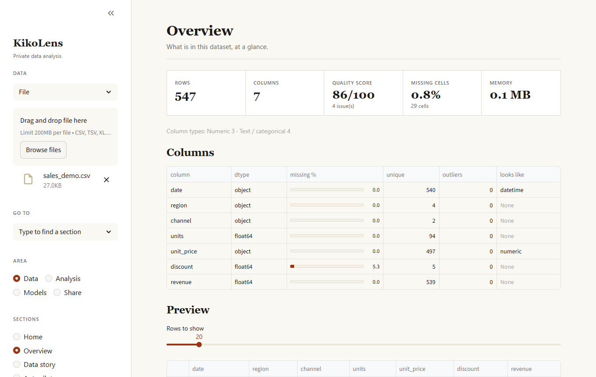

### Autopilot
A first full analysis in one click, for when you open a file and do not know where to start. It cleans with the safe fixes (as recipe steps you can apply to your data), classifies the columns (dates, identifiers, free text, categories, numbers), looks for strong relationships and dominant categories, picks a column to predict from typical names such as `target`, `revenue` or `churn` (or the one you choose), compares a few models against a baseline, and, if there is a date column, forecasts the series. Each phase that cannot run says why and the others continue. It ends with a written summary and concrete next steps. *Thorough* compares every model and tunes the best, which takes longer.

### Explore
Pick a chart type and the columns to plot. Filters (numeric range, date range, category) narrow the rows first. Scatter and density charts sample 20,000 points so they stay responsive.

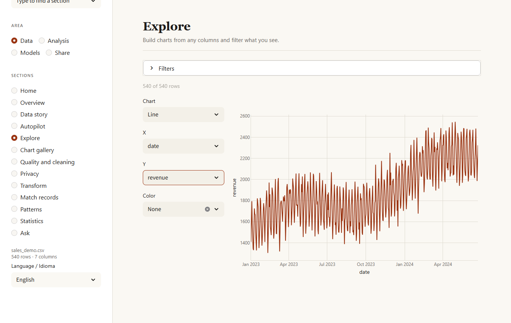

### Quality and cleaning
Lists everything wrong with the data, ordered by how much it matters:

* missing values and columns that are mostly empty
* duplicated rows
* constant columns
* text columns that are really numbers, dates or booleans
* outliers (IQR rule)

**Auto-clean** applies only the safe fixes: trim whitespace, drop duplicates, convert mistyped columns, drop constant columns. Everything else is an explicit operation you choose. **Undo** reverts the last action (Auto-clean counts as one) and **Reset** returns to the file as loaded. The original file is never modified.

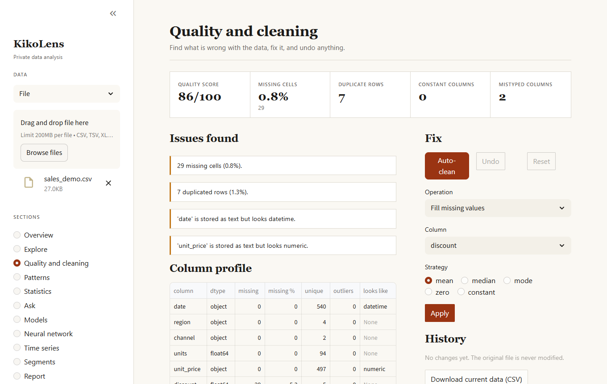

The **Missing data patterns**, **Near-duplicate rows** and **Validation rules** tabs under the cleaning tools go further:

* **Missing data patterns** tells you which columns are empty together and, more importantly, whether the gaps are random. When the chance of a gap depends on another column (for example, income is missing mostly for one region) filling it with a single typical value would bias the results, and the page says so.
* **Smart fill** (in the operation list) fills gaps with **KNN** (from the most similar rows), **iterative** (predicting each gap from the other columns) or **by group** (the median or most common value of each group). It can add a column that marks the filled cells.
* **Merge similar spellings** unifies `New York`, `new york `, `NewYork` and `New Yrok` into the most common form, after showing you what it would merge.
* **Near-duplicate rows** finds pairs that are almost, but not exactly, the same (a typo in a name, a different case) and lets you remove the ones you confirm.
* **Validation rules** are checks written by whoever knows the data: not empty, unique, a range, allowed values, a pattern, "end date is not before start date", "not in the future". KikoLens can suggest rules from the current data, shows which rows break each rule, and saves them as JSON for `kikolens validate` and for monitors.

### Privacy
Finds the columns that hold personal data and lets you decide what to do with each: keep it, mask it (everything but the last two characters), replace it with a salted SHA-256 fingerprint (equal values keep equal fingerprints, so counts and joins still work, but the original cannot be recovered) or remove the column. Detection looks at the content with validated patterns (email, phone, IP address, credit card with its check digit, IBAN with its check, Spanish DNI/NIE with its letter, US social security number) and at column names such as `name` or `birth`. The steps go into the recipe. The second tab, **How identifiable**, measures k-anonymity: for the columns that describe a person (age, postal code, sex, city...) it shows the size of the smallest group a person hides in, how many rows are in a group smaller than the k you want, and the groups that stand out.

### Match records
Joins two tables whose names are not spelled the same way (accents, word order, typos). Upload the second file, pick the name columns and a minimum similarity; every row of the open data gets its best partner if one is good enough. Matches that are not exact are listed for review, and those with a close runner-up are flagged. One click adds the partner's columns (ending in `_right`) and the score, and it can be undone.

### Transform
Six tabs of operations, each recorded as a step:

| Tab | Operations |
| :--- | :--- |
| **Rows** | Filter by a condition (`==`, `>`, `in`, `contains`, `is empty`...), sort, sample a fraction or a number of rows. |
| **Columns** | Create a column from a formula, combine or split text, rename, replace values. |
| **Features** | Date parts (year, month, weekday, weekend, days since start), bins by quantile or equal width, scaling (standard, min-max, robust), log, rank, one-hot encoding. |
| **Sequences** | Lagged values and rolling statistics, ordered by a column and optionally within a group (for example per customer). |
| **Reshape** | Group and summarize, pivot, stack columns. |
| **Combine** | Upload a second file and join it on a key (left, inner, outer, right) or append its rows. |

Formulas accept column names, numbers, `+ - * / // % **`, comparisons and the functions `log`, `log1p`, `log10`, `sqrt`, `abs`, `exp`, `round`, `floor`, `ceil`, `min`, `max`. Put a name with spaces between backticks: ``log1p(`unit price`)``. Division by zero gives an empty value, not an error. Anything else is rejected, so a recipe from someone else cannot run code.

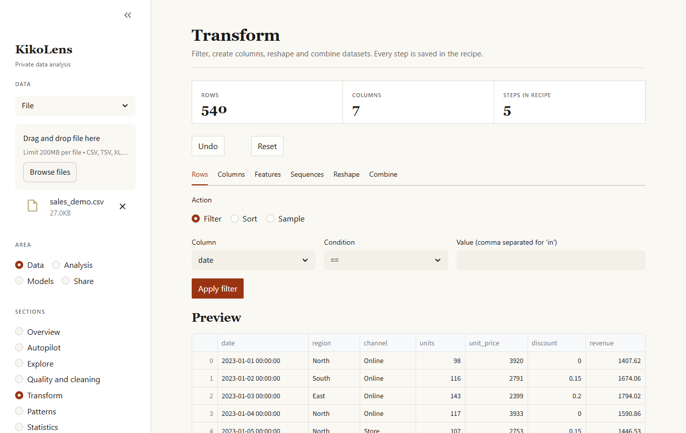

### Patterns
Correlations above 0.85, columns with extreme values, categories that dominate, and probable identifier columns. A button asks the local language model for a written summary (needs Ollama).

### Statistics
A summary table, the distribution of any column, and the correlation matrix with the ten strongest relationships.

### Ask
Type a question and a local model writes the SQL; you can edit it before it runs. The *SQL* tab runs your own queries. The data is the table `df`. Only read-only queries are accepted.

## Analysis

### Experiments
Six tabs that answer "is this real or chance?" in plain language. Each result shows the test used, the p-value, the **effect size** with a label (negligible, small, medium, large) and a conclusion that also says what you cannot conclude.

* **Compare groups.** Pick a number and a column that splits the rows. Two groups: Welch's t-test, or Mann-Whitney when the data are clearly not normal. Three or more: ANOVA with Tukey comparisons, or Kruskal-Wallis with Holm-adjusted comparisons. The page tells you which was chosen and why.
* **Two categories.** Chi-squared test (Fisher's exact for small 2x2 tables) with Cramér's V and a map of where the table departs from chance.
* **Correlation.** Pearson and Spearman with a confidence interval, and a warning when outliers or curvature distort the picture.
* **A/B test.** Control against treatment on a rate (two-proportion z-test and the probability that the treatment is better) or an average (Welch). Includes a planner that tells you how many rows each group needs before you start.
* **A/B (Bayesian).** The same comparison without a p-value: the probability that the variant is better, the likely difference and relative lift with their ranges, and the expected loss of choosing wrongly.
* **What relates to...** Tests every column against a target and corrects for running many tests at once (Benjamini-Hochberg), so a handful of random "hits" are not reported as findings.

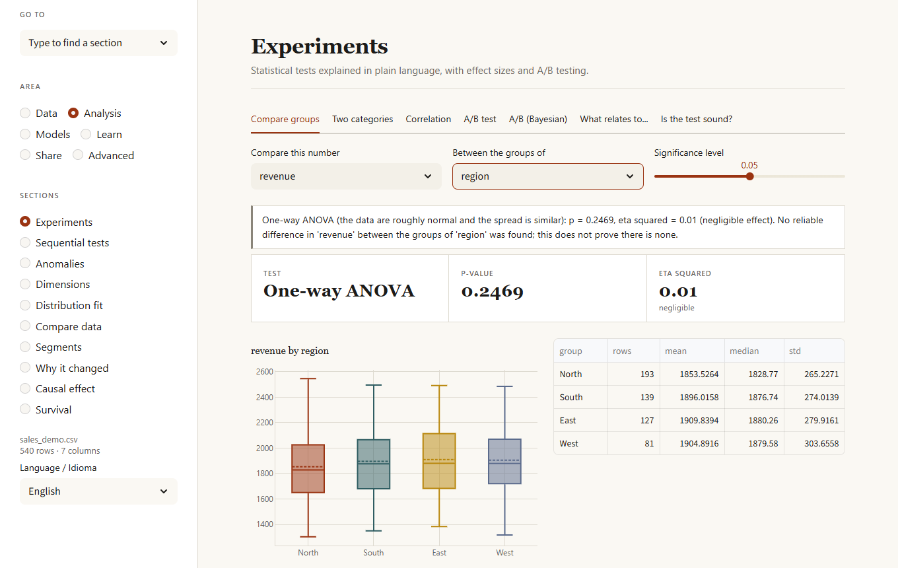

**Is the test sound?** (the last tab) reads an A/B test the careful way. It first checks that each group got the share of users that was planned (a sample ratio mismatch, which usually means a bug and invalidates the test; if it fails, the page refuses to name a winner). It then gives the effect of every group against the control with its 95 % range (several variants are corrected with Holm), uses an earlier measure of the same outcome to remove noise (CUPED) and shows how much narrower the range becomes, plots the effect week by week and warns when it is fading or growing, and looks for segments whose effect differs from the rest of the rows, corrected for the number of segments examined. When nothing is significant it tells you the smallest effect the test could have found, so a small real effect is not mistaken for no effect.

### Anomalies
Choose columns, a method and the share of rows to flag. Methods: Isolation Forest (general purpose), Local Outlier Factor (odd rows inside dense groups), Robust z-score (one column at a time, easiest to explain) and Mahalanobis distance (accounts for correlated columns). Every flagged row comes with the reason, such as "income is 8.2 robust SDs above typical". You can download the rows or remove them (undoable; removal is not stored in the recipe, because the rows are specific to this data).

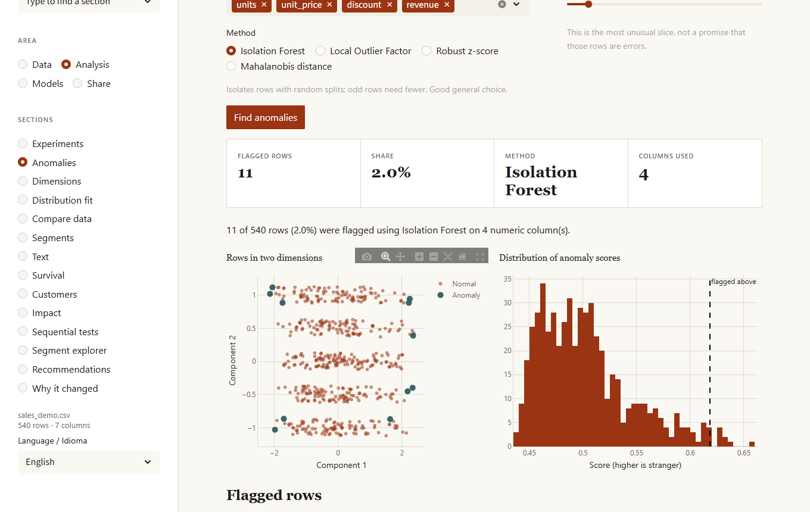

### Distribution fit
Which distribution describes a numeric column best: normal, lognormal, exponential, gamma, Weibull, beta, uniform, Laplace or Student t, ranked by AIC with the Kolmogorov-Smirnov statistic, the histogram with the fitted curve, and a Q-Q plot against the best one. Distributions that cannot hold the data (a lognormal for negative values) are left out, and the page says whether the column looks normal.

### Sequential tests
A/B tests that stay valid however often you look. A classic test is only right if you check once, at the end; checking daily and stopping when it looks significant multiplies the false positives. The **live test** uses a mixture sequential probability ratio test (mSPRT): it shows the evidence building up as visitors arrive, tells you when it is enough to stop, and gives an always-valid p-value and range next to the (misleading if peeked at) classic p-value. The **planner** simulates how many visitors the sequential test needs against a fixed-size test, and how often it raises a false alarm when there is no effect. The **bandit simulator** shows how a Thompson-sampling bandit shifts traffic to the winning variant while it learns, and how many more conversions that gives than an even split.

### Segment explorer
Three ways to find groups of similar rows: a **Gaussian mixture** that chooses the number of groups itself (lowest BIC) and gives every row a confidence, **hierarchical** clustering with a dendrogram, and **DBSCAN**, which follows free shapes and marks the rows that belong nowhere as noise (its radius is chosen from the distances to the neighbours). Each group is described in words ("units high, price low"), drawn on the two main components and summarised in a table; one click adds the group as a column.

### Recommendations
From a table of who used or rated what, an item-based recommender suggests items to a person, lists the items most like another, and is evaluated honestly: one interaction of each person is hidden and the recommender must bring it back among its first suggestions, against simply recommending the most popular items.

### Dimensions
* **PCA.** How many components capture 90% of the variation, what each is made of, and a scatter of the rows on any two components, colored by a column.
* **t-SNE.** A 2D map where similar rows sit together (a sample of 3,000 rows is used on larger data).
* **Redundant columns.** The variance inflation factor of each column: above 5 it is largely explained by the others, above 10 it is nearly a duplicate.

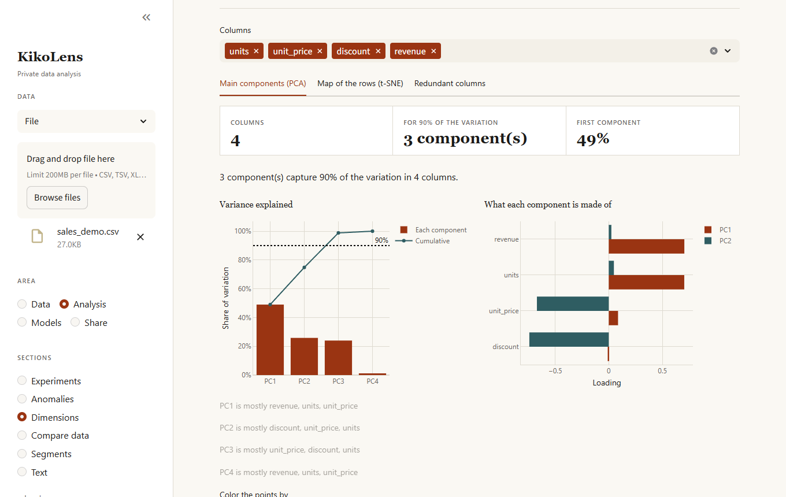

### Compare data
See what changed between two datasets: the first part of the data against the rest, the original file against your working data, or another file against the open one. Each column gets a verdict (stable, moderate, drift) from the population stability index (PSI), a KS or chi-squared test, and notes such as new categories or a changed share of empty values. Dates and columns that are different in every row (identifiers) are shown as *info*, since they are expected to change. Text that holds numbers or dates (`1,200`, `2024-03-01`) is read as such. Columns that exist in only one dataset, or changed from numbers to text, are called out. Use it to check whether new data still looks like what a model was trained on.

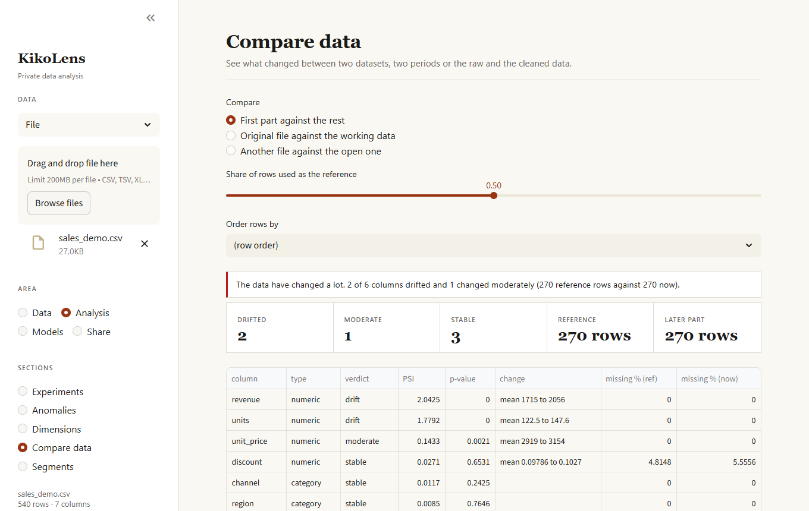

### Text
For columns with sentences, such as comments or reviews. Everything runs on this computer.

* **Terms:** the words, pairs or triples that appear in the most texts, with a search box that shows each match in context.
* **By group:** the terms that distinguish each group of another column (log odds), and the terms that go with a higher or lower number such as a rating.
* **Themes:** groups similar texts and describes each by its key terms and an example.
* **Classify:** learns to predict a column (a rating, a topic) from the text, tells you whether it beats always guessing the commonest class, shows the terms that point to each class and lets you try a sentence.
* **Tone:** a rough positive / negative picture from a small word list (English and Spanish). It does not understand irony or negation.
* **Summary:** asks the local model (Ollama) for the main themes of a sample of the texts.

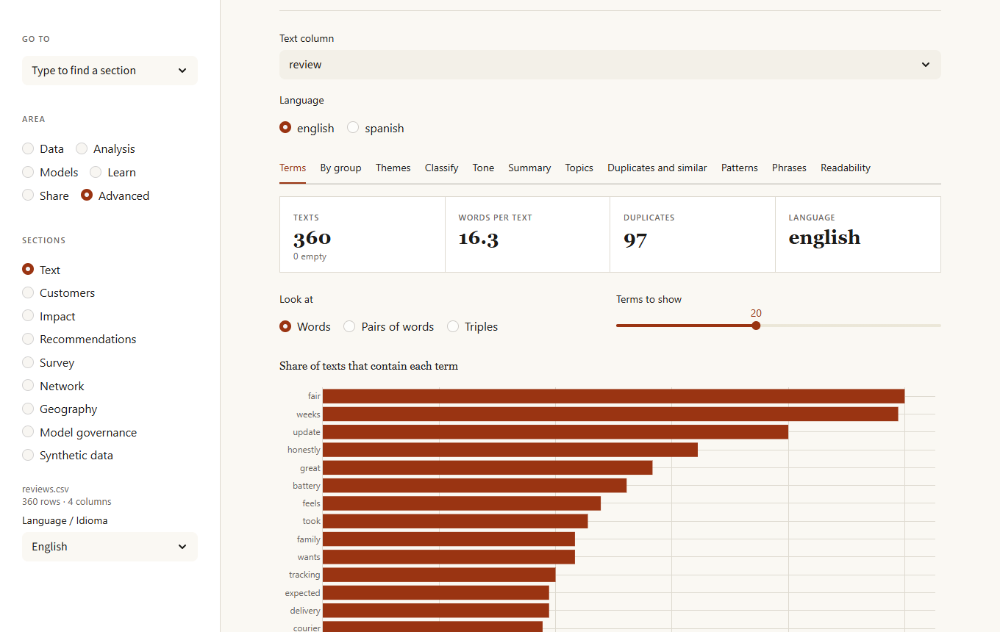

**Topics** finds the themes in the texts with NMF (fast and steady) or LDA, tries 2 to 8 topics and keeps the one whose main words co-occur most (coherence; the table shows the others), lists each topic's main words, its share of the texts and three example texts, and warns when two topics share most of their words or when most texts mix several topics. Pick a date column to see each topic's share by month. **Duplicates and similar** groups near-identical texts (typos and small edits included) and finds the texts most like a phrase you type. **Patterns** lists emails, links, phones, amounts, percentages, dates, hashtags and mentions; they are patterns, not understanding, and personal data found is flagged for the Privacy section. **Phrases** shows key phrases (RAKE) and word pairs that appear together more than chance. **Readability** gives a reading-ease score per text.

### Segments
k-means clustering on the numeric columns, with an optional chart of inertia and silhouette scores to help choose the number of groups. Download the data with the segment label attached.

### Survival
How long until something happens (a customer leaves, a machine fails, a lead buys), counting the cases that have not happened yet. Pick the time column, the column that says whether the event happened (1 or yes, 0 or no) and, optionally, a column to compare groups. You get Kaplan-Meier curves with their confidence bands, the time by which half of each group had the event, and a log-rank test that says whether the groups really differ.

### Customers
Four tabs for behaviour data.

* **Retention.** Cohorts by the period of each customer's first activity, and the share of each cohort still active one, two, three periods later. Periods that have not happened yet are left blank, not shown as zero.
* **Segments (RFM).** Recency, frequency and spend scored from 1 to 5 and turned into segments (champions, loyal, big spenders, new or promising, at risk, lost), with the share of the value each one holds. Download every customer with their segment.
* **Funnel.** Choose the stages in order; users count at a stage only if they also reached the earlier ones, and the biggest drop is named.
* **Bought together.** Association rules (Apriori) from an order column and an item column, with support, confidence and lift.

### Why it changed
A figure moved between two periods; which regions, channels or products explain it? Pick the date column, whether to measure a total, an average or the number of rows, and the two periods (by default the last third of the dates against the one before). The page ranks the columns by how much of the change sits in their single biggest value, draws a waterfall of what moved it for any column, and, for totals and counts, lists the combinations of two columns that moved most. For an average the change is split into a **mix** effect (the weight of a value changed) and a **rate** effect (the average inside the value changed).

### Impact
Did a change move the numbers? **Before and after a date** compares what happened after the change with what the earlier trend (or, much better, control series that the change did not touch) predicted. The range comes from how wrong the same method was at predicting earlier stretches where nothing happened, so it is not overconfident. **Treated and control groups** is a difference-in-differences estimate with a confidence interval. Neither proves causation: they only count as the effect of the change if nothing else changed at the same time.

## Models

### Models
AutoML picks an algorithm from the size and shape of the data and explains why. You can also choose the algorithm or import a model you trained earlier. Results include metrics, feature importance, a row explanation and a what-if simulator.

### Model lab
The careful way to choose a model. Pick the target, the columns to leave out and the models to compare; the lab keeps a share of rows aside, scores every model with cross-validation on the rest, tunes the best one with a randomized search, and only then measures it once on the held-out rows. Along the way it:

* warns about **data leaks**: columns that predict the target suspiciously well on their own
* warns about **imbalanced classes** and can weight rarer classes
* draws diagnostics: predicted against actual and residuals (regression), confusion matrix, ROC, precision-recall and calibration (classification), and a learning curve
* explains the model with permutation importance, partial dependence for any feature, and the effect of each feature on one chosen row

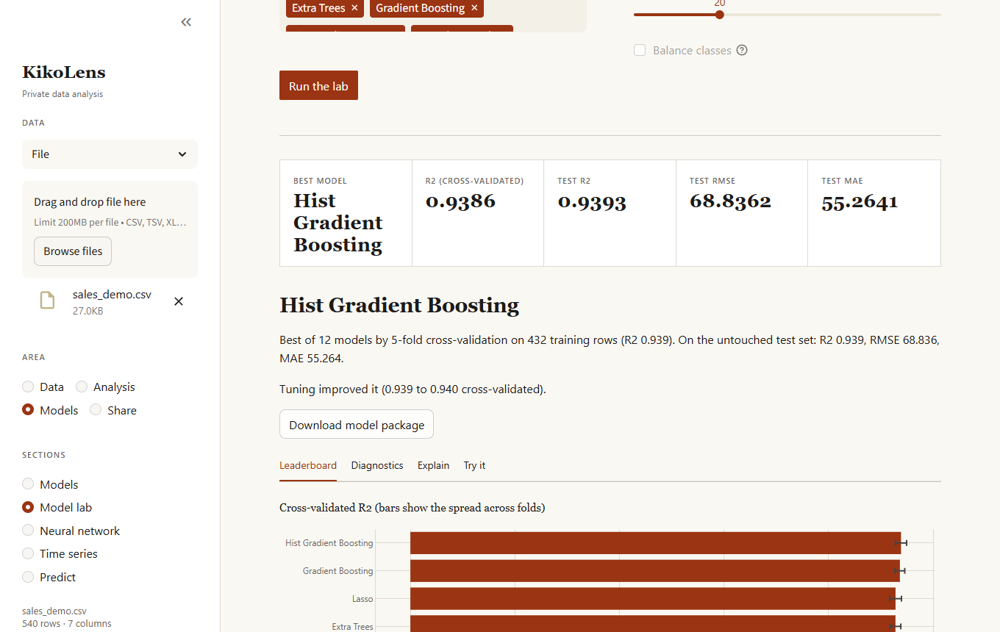

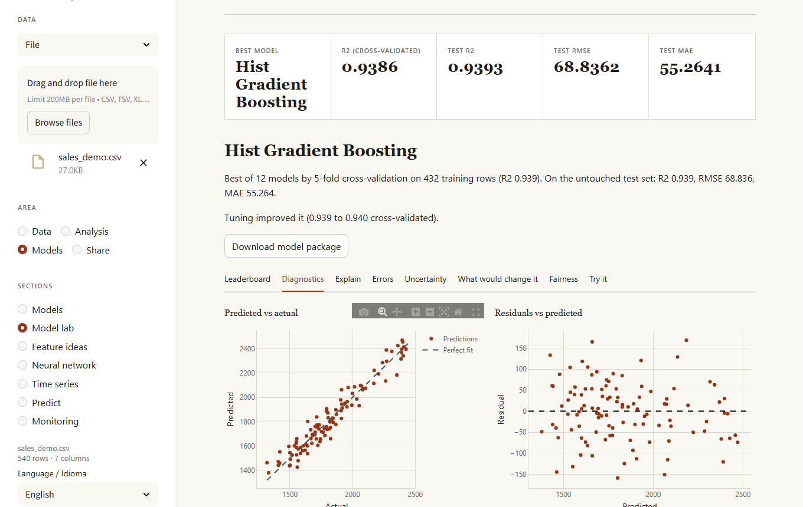

The **Explain** tab adds Shapley values for one row (the contribution of each feature, fairer than replacing one at a time when features are related) and a global importance computed from them. The **Errors** tab answers "where does the model fail?":

* segments (a value of a category, a band of a number) where the error is clearly higher than average, with how many times worse and how sure that is
* the rows it gets most wrong
* for two-class problems, what each decision threshold gives (precision, recall, F1) and the cheapest threshold for your cost of a false alarm and of a miss
* a row-by-row comparison of any two models, with a verdict on whether the difference is statistically reliable

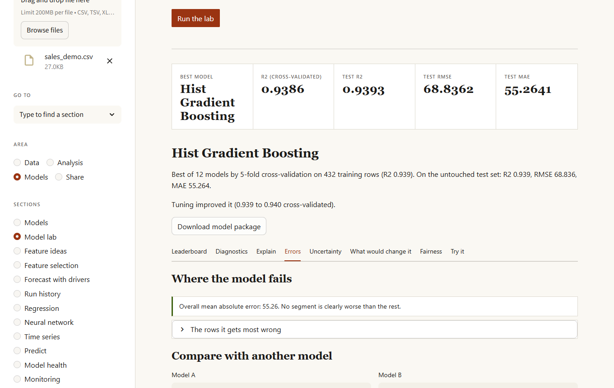

Three more tabs look at the trained model from other angles:

* **Uncertainty.** A range around each regression prediction, or a short list of plausible classes for each classification row, that holds the truth about as often as you ask (80 to 99%). It is calibrated on half of the test rows and checked on the other half, and it shows the coverage actually observed.
* **What would change it.** Pick a test row and the answer you would like (another class, or a value above a number) and the lab searches for the smallest changes to one or two variables that get there, leaving fixed the ones that cannot change (age, country). Useful to explain a decision and to see which levers exist.
* **Fairness.** For a classifier, how each group of another column is treated: the rate of the favourable result, the true and false positive rates and the accuracy, with a warning when a group gets the favourable result at less than 80% of another group's rate or when error rates differ by more than 10 points. It cannot say what is fair, only what you would need to justify.

The model list also offers SVM, AdaBoost, Bagging, a voting ensemble and a stacking ensemble (slower, so unticked by default) and, if PyTorch is installed (`pip install "kikolens[torch]"`), a PyTorch multilayer network that takes part in the same comparison, tuning and model packages.

### Feature ideas
Tries new columns (products, ratios, sums, differences, logarithms of skewed columns, squares) and keeps, one at a time, the ones that improve a model in cross-validation by at least the amount you set. The result is a list of formulas; one click adds them to your data as `add_column` steps, so they are in the recipe and replay on new data.

### Regression
For understanding rather than predicting: what pushes a result up or down, other things equal. A column with numbers gets a linear regression; a column with two values gets a logistic regression. Pick the columns to explain it with and you get each effect with its standard error, its 95% range and its p-value, a coefficient chart, the effect of each term written as a sentence ("each extra unit of size goes with price rising by 3.01, other things equal"; "a support ticket multiplies the odds of leaving by 1.6") and the standardized effect so that terms in different units can be compared. Categories are compared with the commonest value. The page warns about columns that are largely explained by others (unstable coefficients), errors whose spread changes with the fit or that are related from row to row (p-values too optimistic), and, for logistic regression, a column that almost gives the answer away.

### Feature selection
Which columns are worth keeping to predict a target. Four methods score every column (mutual information, an L1-penalised linear model, permutation importance and a random forest) and vote; a cross-validated curve shows the score using the best k columns and the page recommends the smallest k within one standard error of the best. One click adds a recipe step that drops the columns you can leave out.

### Forecast with drivers
Forecasts a series using other columns too (price, promotions, weather...). It tests on the past whether the drivers really beat the series alone, with a significance test, and lets you try **what-if scenarios** ("price 10% higher"). The second tab runs a **Granger test**: does the past of one column help predict another? It is about prediction, not proof of cause.

### Causal effect
Did a treatment really change an outcome, or do the treated rows simply differ from the rest? Five tabs. **Effect of a treatment** compares the raw difference with regression, inverse-propensity weighting, matching and a doubly robust estimator (cross-fitted, with bootstrap ranges), and shows the overlap of propensities, the covariate balance before and after weighting and an **E-value**: how strong an unmeasured factor would have to be to explain the result away. **Who responds most** estimates the effect per row with two models (one per group), ranks rows by predicted uplift and draws a Qini curve against random targeting. **Threshold** estimates the jump where a rule kicks in (a score cut-off, an age limit) with local regression, several bandwidths and a test for rows piling up on one side. **Synthetic control** builds a weighted mix of other units that follows the treated one before the intervention and runs placebo tests on every control unit. **Instrument** runs two-stage least squares and warns when the instrument is weak (first-stage F below 10). Every method states its assumption; none of them can prove that no confounder is missing.

### Simulation
Three tools. **Monte Carlo** evaluates a formula thousands of times with uncertain inputs: choose columns of your data (their values are resampled and their rank correlation is kept) and type others as `name = normal(10, 2)`, `uniform`, `triangular`, `lognormal`, `beta`, `poisson` or `fixed`; add correlations between them if they move together. You get the average, the median and the 5th and 95th percentiles, the chance of going above a value you choose, the value at risk, a tornado that shows which input moves the result most and a chart that shows the average settling. **Linear program** finds how much of each thing to do for the best total within limits, with optional whole-number variables, and says how much the objective would change if each limit were relaxed. **Optimize a formula** searches a non-linear formula from several starting points, within bounds and restrictions such as `x + y <= 20`.

### Marketing mix
Two tabs. **Channels and budget** takes weekly or daily spend by channel against an outcome: each channel gets a carry-over (spend keeps working in the following periods) and a saturation curve (each extra unit adds less), next to a trend, a season and any controls you add. Parameters are chosen by how well the model predicts the last fifth of the periods, and the table says which channels can be told apart from zero effect, how much each returns per unit, the return of the next unit and whether the channel is already saturated. Channels that move together cannot be separated and the page says so. Below, a budget split moves spend between channels (within bounds around today's spend) to raise the total outcome, and shows today against proposed. **Price elasticity** fits a log-log model: the coefficient of price is how many percent the quantity changes for 1 % more price, per group if you like, with an optional instrument and the revenue or margin curve.

**Attribution** (third tab) takes a table with one row per contact of a person with a channel (who, when, which channel, and whether it ended in a conversion; optionally the value). It shares the credit for the conversions with seven models next to each other: first touch, last touch, linear, time decay (a contact counts half after the number of days you choose), position based (40 % first, 40 % last, 20 % the rest), a Markov chain and Shapley values. The last two look at the whole path: the Markov chain measures how much the chance of converting would fall if a channel did not exist, and Shapley gives each channel its average contribution to every possible combination of channels. Where the models disagree, the channel is doing a different job from the one the last-touch report gives it (opening the path rather than closing it). Attribution shares out the credit for what happened; it does not tell you what a channel causes, so confirm the big decisions by switching a channel off for a group.

### Classical series
Four tabs on one series (rows of the same period are combined by mean or sum). **Stationarity** runs ADF (null: unit root) and KPSS (null: stationary) on the series and on its first and second differences and says what the two tests say together: when they agree the verdict is firm, when they disagree the page tells you it is inconclusive and why, and it suggests how many differences to take. **Autocorrelation** draws the autocorrelation and partial autocorrelation with the band that noise would give and the Ljung-Box test. **STL decomposition** separates trend, seasonal pattern and remainder, robustly if you ask (outliers then stay in the remainder instead of bending the trend), with the strength of trend and season from 0 to 1 and the unusual points. **ARIMA** fits a model with seasonal terms, either one you choose or the best of a small search by AICc (listed under "Models tried", with a warning when several are indistinguishable), draws the forecast with its range and checks it against repeating the last season on stretches it did not see; if the simple method wins, the page says so.

### Model governance
Three tabs. **Overview** lists every registered model with its stage, owner, risk, latest validation and whether a review is due, and warns when a model file no longer matches what was registered. **Model** takes a saved model through its life: register it with an owner, a risk level and a card (purpose, intended use, limitations); validate it on the open data, which must contain the real results (the page says whether it holds up and gives the range the result could fall in); see, for the stage you choose, which checks pass and which do not, and move it; approve it (for high risk, by someone other than the owner); and roll production back. Overriding a failed check needs a reason and is logged as an override. **Audit log** verifies the chain of hashes and lists every action. The name you type as "who is doing this" is recorded as typed: the log is a record for the team, not access control.

### Network
Choose the two columns that name the ends of each link (customer and product, sender and receiver, author and paper), optionally a column with the strength of each link, and whether links have a direction. **Overview** lists the nodes by importance (PageRank, number of connections, betweenness: how many shortest paths pass through the node, and clustering: how many of its neighbours know each other), the communities found, how much of the network is in one connected piece, the typical and longest distance, and a drawing of the most important nodes coloured by community. Notes say when the network is split, depends on a few hubs or has bridges: nodes with few links that hold parts together. **Paths** finds the shortest chain between two nodes. **Missing links** suggests pairs that are not linked but share many neighbours. **Robustness** removes the best-connected nodes step by step and shows how fast the largest piece shrinks compared with removing random nodes.

### Geography
Pick the latitude and longitude columns (they are found by name and range). **Check and map** counts the usable rows and warns about swapped columns, values out of range, missing coordinates and the 0, 0 point that GPS devices report without a signal, and draws the points on a globe with no map tiles; coastlines and countries are optional because Plotly downloads those shapes. **Distances** gives the kilometres to a place or to the nearest centre in a CSV of shops or warehouses, and how many points each centre serves. **Zones** finds dense groups of points, optionally averaging a column in each. **Spatial pattern** asks whether nearby places have similar values (Moran's I, with a permutation p-value) and marks hot and cold spots (Getis-Ord Gi*), corrected for the many places tested at once. **Grid** summarises points in square cells of the size you choose. Distances are along the surface of a sphere, which is accurate enough for business decisions but not for surveying.

### Process control
Three tabs for anything measured over time in order: a production line, delivery times, a daily metric. **Control chart** draws the values with a centre line and limits at three standard deviations, chosen for the kind of data (individual values, means of subgroups, share defective, defects per unit or number of defects) and marks the points that break the signal rules you switch on. Limits can be set from the first points only and then frozen to monitor the rest; points outside the limits in that first stretch are set aside before the limits are computed, because they are special causes. Every rule you add finds changes sooner and also raises the false-alarm rate, which the page states. **Capability** compares the process with the specification limits you give: Cp and Cpk use short-term variation, Pp and Ppk the overall variation, and a gap between them means the process drifts. **Small shifts** uses CUSUM and EWMA, which add up small deviations and catch a sustained change of about one standard deviation far sooner than a control chart does, and CUSUM also estimates when the shift began.

### Inventory
Four tabs. **Which items matter** ranks items by value (class A covers the first 80 % of it, B the next 15 %, C the rest) and, with a date, by how much demand varies (X steady, Y moderate, Z erratic) and by pattern: smooth, erratic, intermittent (sells in few periods) or lumpy (few periods and very uneven sizes), each with the approach that suits it. High-value items with erratic demand are called out. **Plan for every item** turns a table of sales into a safety stock and a reorder point per item for the service level you choose and the delivery time you give (and its variation), plus the economic order quantity if you know the cost of an order and of holding a unit. **Sold once** answers the newsvendor question for seasonal or perishable goods: how much to order given the cost, price and what an unsold unit is worth, from a mean and spread or from past seasons in your data. **Reorder policy** calculates the safety stock, the reorder point and the fill rate for one item and then simulates many years of that policy, so you see the service it actually gives next to what the formula promises.

### Survey
Seven tabs for questionnaire data (one row per respondent). **Questions** summarises the scale questions (numbers such as 1 to 5, or texts such as "Agree" and "Strongly agree", in English or Spanish): average, share favourable, neutral and unfavourable, and the spread of answers; questions worded the other way round can be reversed. **Reliability** gives Cronbach's alpha for a group of questions that measure the same thing, its 95 % range, how well each question moves with the rest and what alpha would be without it, and points at questions that look reversed. **NPS** computes promoters minus detractors with its range and, by group, which groups stand out from the rest. **Cross-tab** crosses two questions with the chi-square test, Cramér's V and residuals that show which cells have more or fewer answers than chance. **What matters most** uses relative weights to share the explained part of an overall rating between the questions that may drive it, even when they overlap, and crosses importance with score: important and low-scoring means improve first. **Between groups** finds the questions that score differently, using tests for ordered answers and a correction for the number of questions. **Answer quality** counts people who gave the same answer to everything, left most blank or answered too fast.

### Concept lab
An area of its own ("Learn") for understanding the ideas behind the other sections, with simulations instead of formulas. It needs no data and can be opened from the welcome screen. Pick a concept, move its controls and the simulation redraws; **Draw new random data** repeats it with another sample so you see what changes (the numbers) and what does not (the lesson). Each concept ends with what to take from it and something to try:

* **The central limit theorem:** choose a skewed, two-humped or heavy-tailed population and see the averages of n values turn into a bell as n grows.
* **What a p-value is:** with no real effect, about 5 experiments in 100 look significant, and checking the result ten times and stopping at the first success raises that to about 20.
* **What "confidence" means:** draw 100 intervals and count the ones that miss the truth; with tiny, skewed samples the promise of 95 % is not kept.
* **How many people are enough:** the power curve, the sample needed for the effect you choose (64 per group for half a standard deviation) and why half the effect needs four times the people.
* **Bias, variance and overfitting:** polynomials of growing complexity fitted to noisy data, with the error on the data used and on new data split into bias, variance and noise.
* **Simpson's paradox:** a trend that goes up in every group and down in the whole data.
* **Regression to the mean:** why the best of one year fall back the next with no change in anyone.
* **Why testing many things finds something:** twenty tests with nothing real still give a false alarm in two studies out of three, and what two corrections do about it.

### Glossary and reading guides
**Glossary** (Learn area) lists 74 terms, from p-value to Cpk, each with a plain definition, a "watch out" line with the usual misreading, and related terms. Search matches names first and then definitions, and the language follows the one you chose for the dashboard. At the end of 27 sections (experiments, causal effect, regression, model lab, time series, text, network, survey and others) a closed box called **How to read this page** says what to look at first, what to be careful about and defines the words that help for that page. The same glossary is available as `kikolens glossary` and `kl.glossary`.

### Run history
Every training of the model lab (dashboard or `kikolens lab`) is recorded with its data, target, parameters and metrics. See them over time with the best so far, sort by any metric, and compare runs side by side (only what differs). The lab can also tune with **Bayesian optimisation**, which learns from each attempt to choose the next one and shows how the search went.

### Neural network
A multilayer perceptron you configure: hidden layers (presets or your own, e.g. `128, 64, 32`), activation, optimizer, learning rate, L2 regularization, maximum epochs, early stopping and the held-out share for testing. After training you get metrics, the network diagram, the training curve, permutation importance and, if a classical model was trained for the same target, a side-by-side comparison.

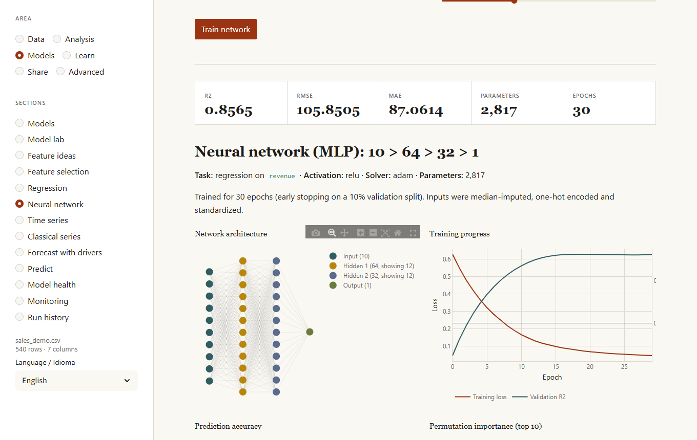

### Time series
Choose a date column and a numeric column. The page resamples to a regular period, estimates trend and seasonality, and forecasts ahead with a 95% range. The forecast is tested on the last part of the data and compared with repeating the last value; the page says plainly when it does not beat that baseline.

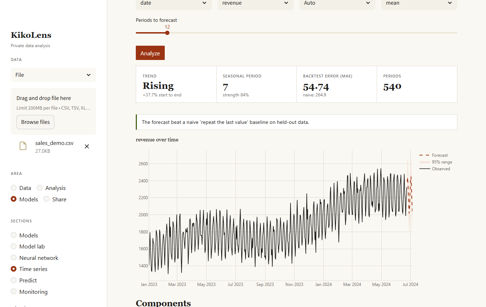

Below the forecast, **Go further** has three tabs. **Compare models** tests five models (naive, seasonal naive, trend + seasonality, Holt-Winters and boosting on lags) by training each on the past and forecasting the stretch that follows, several times; the most accurate wins, and the range comes from the real errors it made. You can list special dates (a campaign, a holiday) that the boosting model uses. **Changes in the series** finds level shifts and trend changes and stays quiet on a series without them. **One forecast per group** forecasts each region or product separately.

### Predict
Use a model on data it has not seen. Choose a model trained in this session, one from your saved models, or open a model file, then:

* **Predict a file.** Use the open dataset or upload another file. Before predicting, the page lists problems with the input: missing columns, values that could not be read, categories never seen in training, numbers far outside the training range. Regression gives a likely range for each row; classification gives a confidence, and rows under 60% are counted so you know where to look first. If the file is raw, tick the box to repeat the cleaning steps used for training.
* **Predict one row.** A form built from what the model expects, with the training range of each input.
* **Save and share.** Keep the model in your saved models (saving the same name again creates a new version), download the package, or download a Markdown model card with its metrics, most influential features and expected inputs.

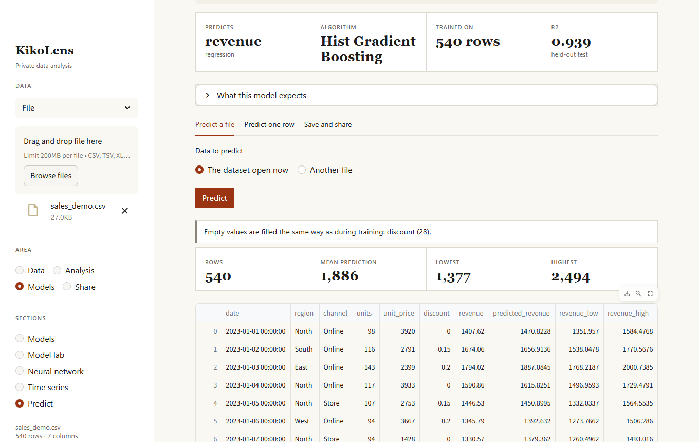

### Model health
Is a saved model still as good as when you tested it? Choose a model and upload newer data that includes the real results (the column the model predicts). The page scores every period (or five consecutive parts if there is no date), draws the error or accuracy against what the model had in testing, and warns when a period is clearly worse (an average error 1.5 times higher, or an accuracy 10 points lower) or when it keeps getting worse over time. Drift in the inputs is a clue; this is the proof. The **Compare models** tab scores several saved models on the same data and says which predicts better and whether the gap is reliable or could be chance.

### Monitoring
Watches a data source over time. Create a monitor from the data open now (it becomes the baseline), optionally with a saved model and validation rules; then check new data, either a file you upload or the file the monitor watches. Each check records the number of rows, the quality score, drift against the baseline, broken rules and the model's predictions, and raises alerts: drift at the level you chose, a drop in quality, a large change in rows, missing or new columns, columns that changed from numbers to text, model inputs outside what it saw in training, and a shift in the average prediction or in the model's confidence. The history is a chart and a table. KikoLens does not schedule anything itself: the **Schedule it** panel gives the cron and Windows commands.

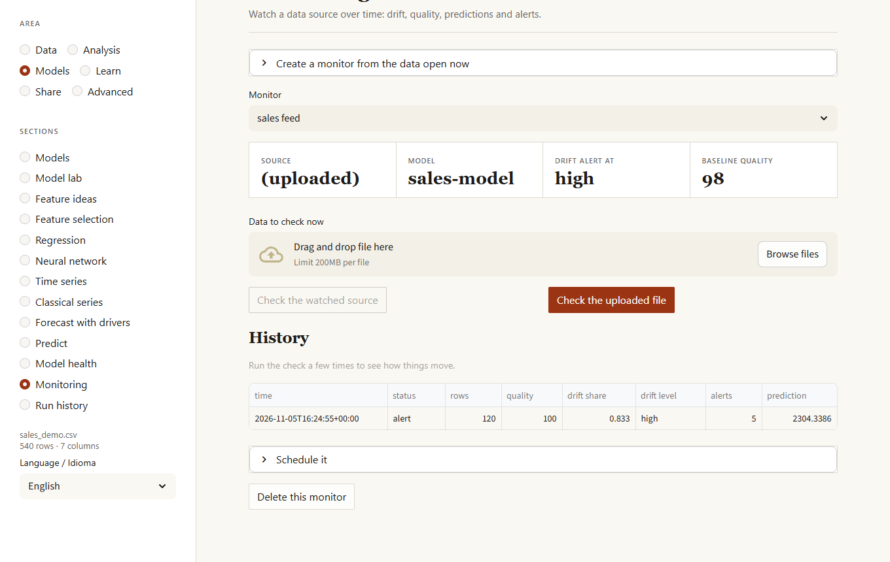

## Share

### Panel
A page of your own. Add **metrics** (count, sum, mean, median, minimum, maximum, distinct values), **charts** (bar, line, area, scatter, histogram, box, pie) and **tables**, set filters that apply to the whole panel, and reorder or remove tiles. **Suggest a panel** builds a starting point from your columns. **Click a bar or slice, or drag a box on a histogram, scatter or line, and the other tiles filter to what you selected** (the chart you clicked keeps showing every option so you can change your mind); the active selections are listed above the tiles and **Clear the selections** removes them. Download it as one self-contained web page (charts included, the data is not), as a **PowerPoint** (a cover with the filters, key figures, one slide per chart with a native chart you can edit, tables) or a **Word** document (charts as images), both including the current selection, or as a JSON definition that you can reload and that is saved in your project. PowerPoint and Word need `pip install "kikolens[office]"`; they are prepared when you ask for them.

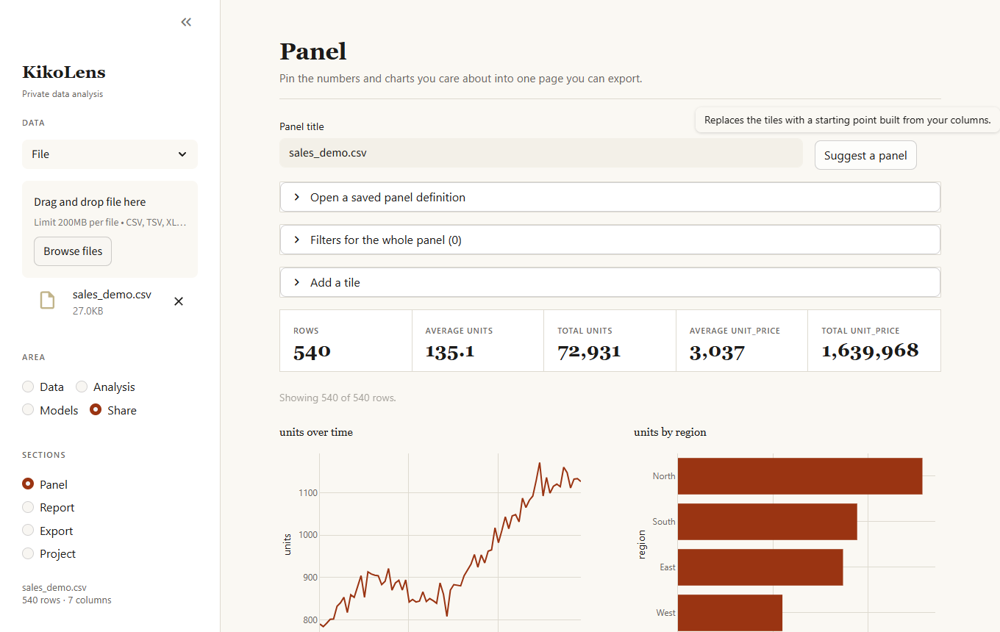

### Export
* **Files:** CSV, TSV, Excel, Parquet, JSON, JSON lines or Feather.
* **Excel workbook:** one file with the data, the column profile, statistics, quality issues, the recipe, rule results, model metrics and the last predictions, each on its own sheet, with a highlighted header, frozen first row, filters and sensible widths. Text that starts with `=` is stored as text, never as a formula.
* **Database:** writes the current data as a table. It stops if the table exists unless you choose to add rows or to replace it, and replacing needs a confirmation.

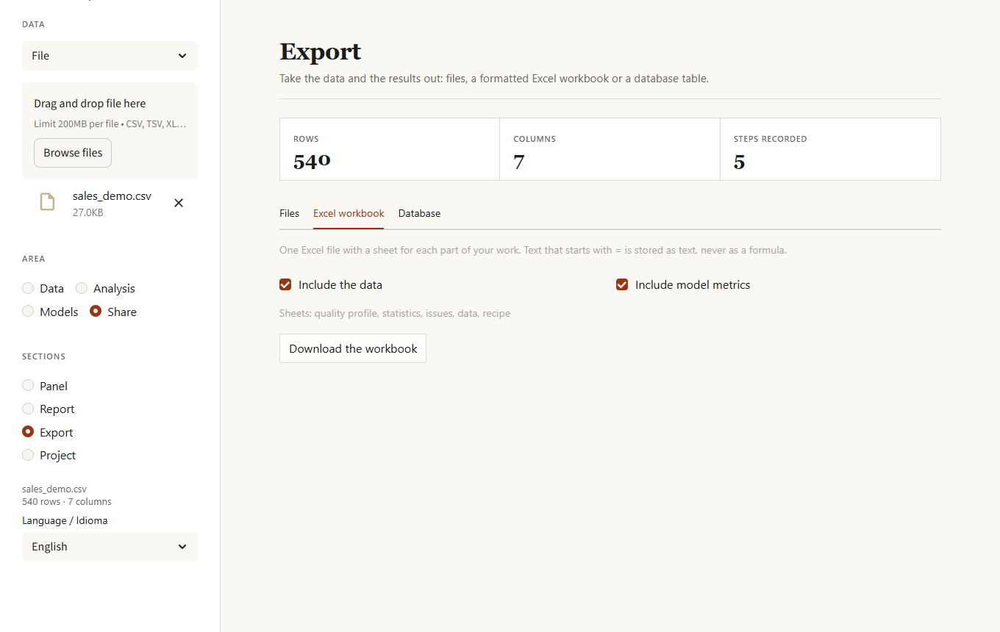

### Synthetic data
Generates a table that looks like yours (each column with its distribution, and the columns with the same correlations) but whose rows are not real people, with a report on **fidelity** (how close the distributions and correlations are), **privacy** (exact and near copies of real rows) and **utility** (a model trained on the synthetic data against one trained on the real data, both tested on real rows).

### Data dictionary and notebook
Two more tabs in *Export*. The **data dictionary** has one entry per column (meaning, empty share, distinct values, typical values, range, warnings such as "mostly empty" or "may contain personal data") and you write the descriptions in the table itself; download it as Markdown or CSV to hand over with the data. The **notebook** is a Jupyter file that reloads the data, repeats every recipe step of the session and, if you choose a column, trains a model with the lab; it runs as is.

### Report
Builds one self-contained HTML page with quality, statistics, correlations, patterns, any models trained in this session and, optionally, commentary from the local model. It also builds a PDF (cover, quality, distributions, correlations and, when available, the model and the autopilot's forecast) that you can download directly.

### Project
* **Save.** Packs the original data, the recipe, extra datasets, your notes and, if you tick it, the trained models, into one `.kikolens` file.
* **Open.** Restores all of that and replays the recipe, so you land exactly where you stopped. Data are stored as Parquet and never run code; models inside are loaded only when you confirm you trust the file.
* **Recipe.** Every cleaning and transformation step, downloadable as JSON or as a Python script. Upload a recipe and a new file with the same columns to get it processed the same way.

## Dark theme

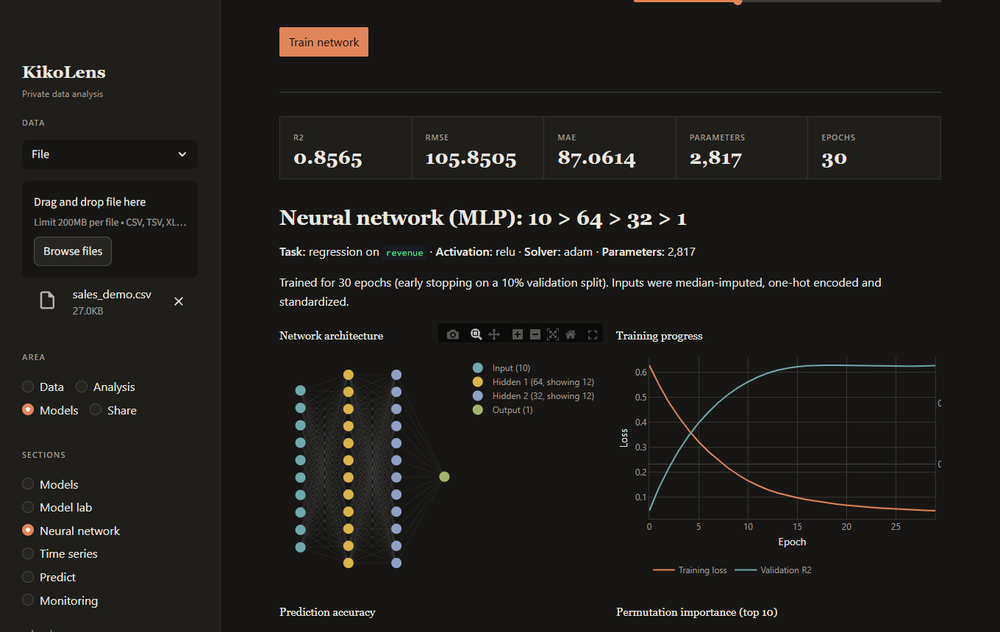
