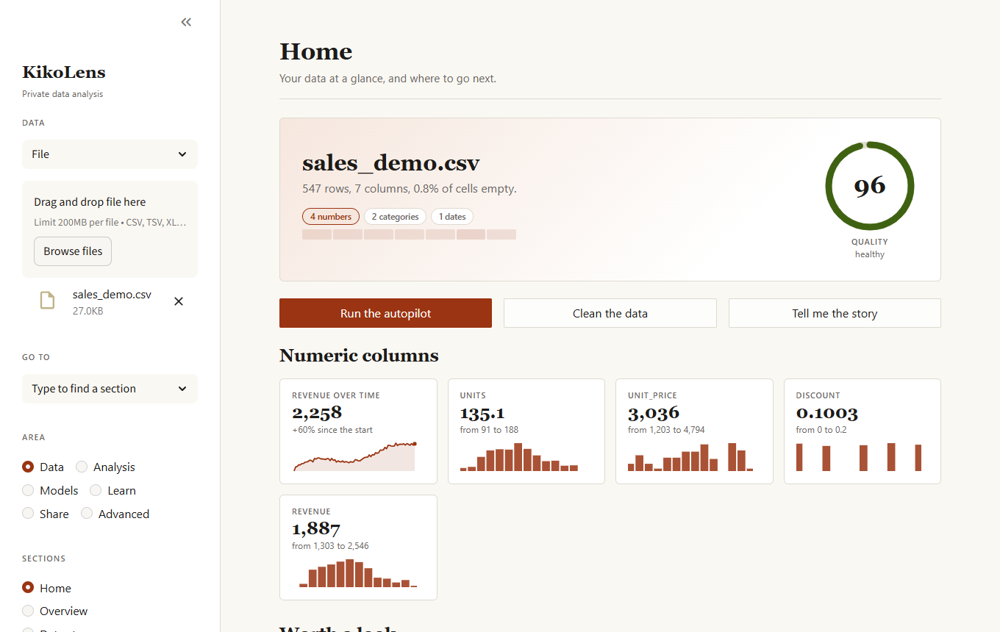
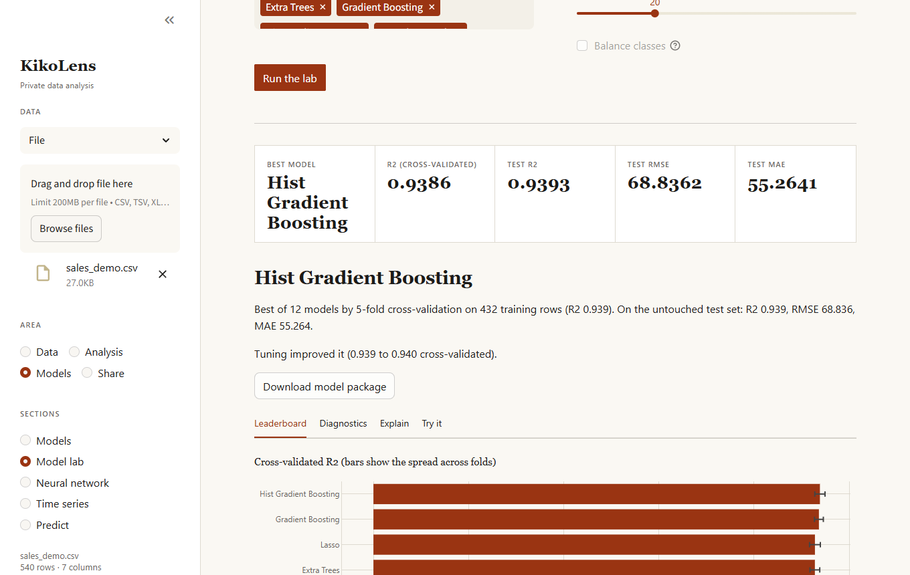

# KikoLens

Private, local-first data analysis. Load a dataset, let the autopilot take a first pass, clean it, explore it, test hypotheses, compare many
models and understand them, forecast, study customers and the effect of a change, watch a data source over time, and keep what you built:
a recipe you can replay, a model you can score new data with, a panel and a report. Nothing leaves your machine; the optional
language-model features use [Ollama](https://ollama.com/) running locally.



## Start here

```bash
pip install "kikolens @ git+https://github.com/Francisco-B-O/kikolens.git"
kikolens doctor       # check the installation
kikolens start        # open the dashboard, then pick "Or try an example" or load your own file
```

| If you want to... | Read |
| :--- | :--- |
| Click through the app | [Dashboard guide](dashboard.md) |
| Script it or run it on a schedule | [Command line](cli.md) and [pipelines](cli.md#pipeline-files) |
| Use it from a notebook | [Python API and Jupyter](python-api.md) |
| Follow a complete example | [Workflows](workflows.md) |
| Know how a result is computed and when not to trust it | [How it works](models.md) |
| Change settings (Ollama, port, language) | [Configuration](configuration.md) |
| Contribute | [Development](development.md) |

## What is in the box

* **Data:** home page, data story, chart gallery, quality and cleaning (undoable, as replayable recipes), privacy tools, record matching, synthetic data.
* **Analysis:** statistical tests with effect sizes, sequential A/B tests, anomalies, regression, survival, customers, impact of a change, segmentation, recommendations, text.
* **Models:** autopilot, model lab (twelve models plus ensembles, Bayesian tuning, explanations, ranges, counterfactuals, fairness), forecasting with drivers, neural networks, monitoring and run history.
* **Share:** panels, HTML and PDF reports, Excel, notebooks, a local model API, in English and Spanish.


